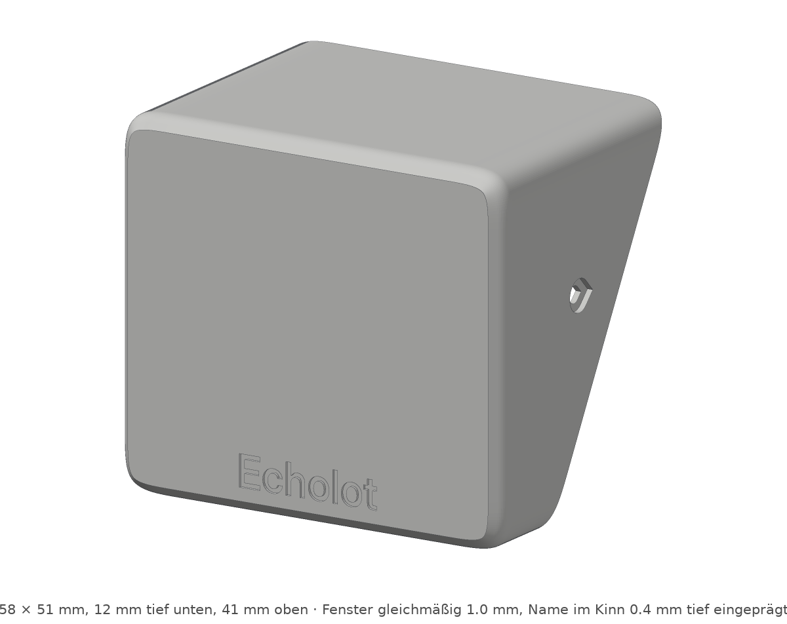
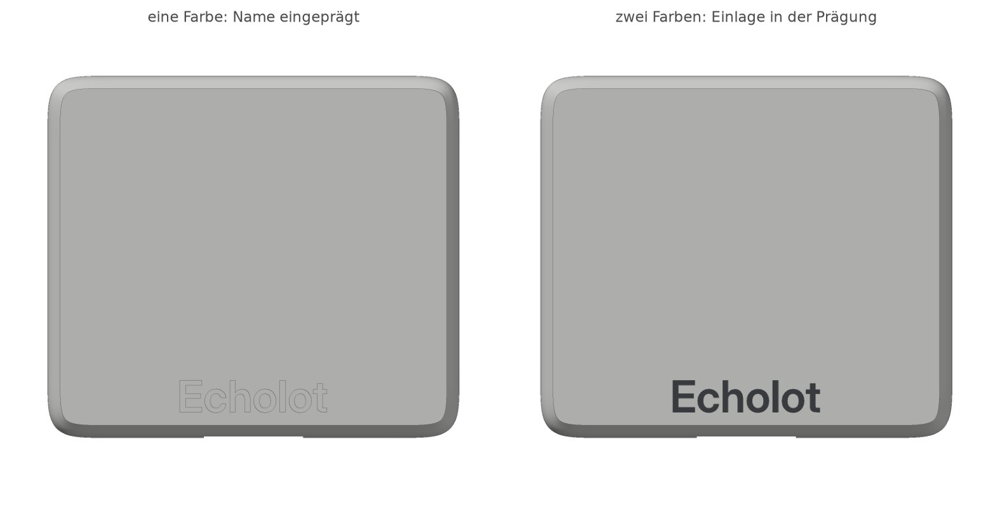
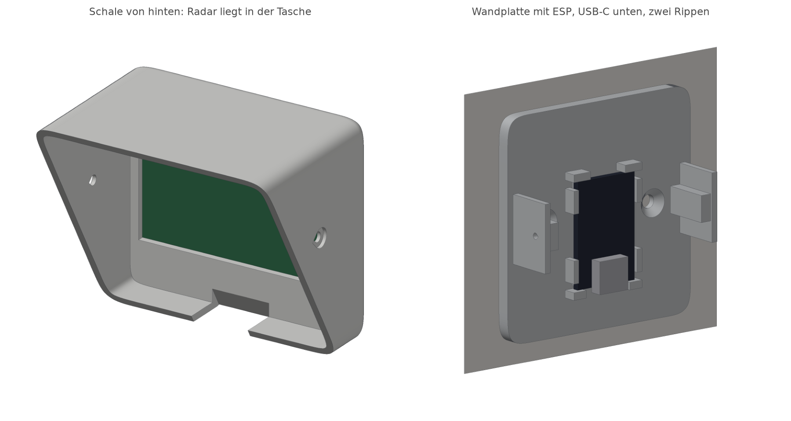
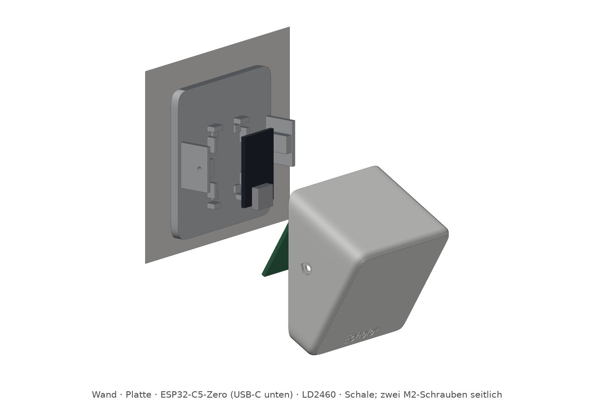
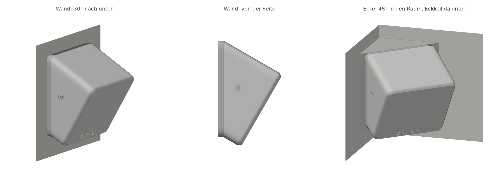
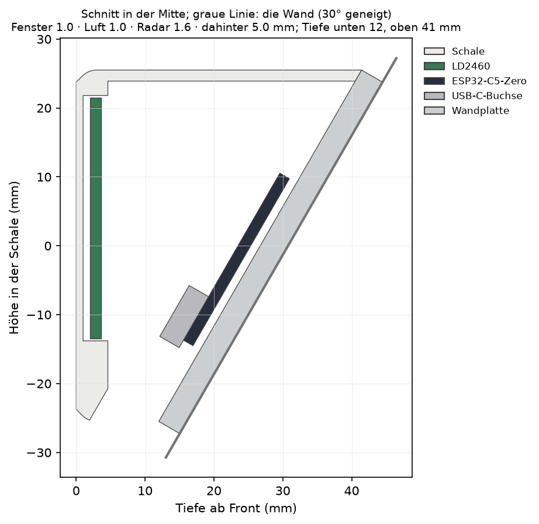

# Gehäuse für LD2460 + ESP32-C5-Zero

Eine schlanke Schale (58 × 51 mm) für das HLK-LD2460, gestaltet in der Art
von Apple-Geräten, mit dem ESP32-C5-Zero auf einer Wandplatte dahinter:

- Squircle-Ecken: Die Krümmung setzt sanft ein, ohne Knick.
- Eine weich gerundete Vorderkante.
- Front und Oberseite ohne Schlitze oder Schrauben.
- Unter dem Radarfenster ein schmales „Kinn“ mit dem eingeprägten Namen
  **Echolot** in Inter Display.
- Hinter einem gleichmäßig 1 mm dünnen Fenster sitzt das Radar.

**Die Schale ist der Neigungskeil.** Ihre Rückseite liegt 30° schräg, also
neigt sie sich von selbst nach unten. Es gibt keine Schiene, keinen Halter
und keine Rastnasen. Drei Teile, zwei Schrauben:

1. Die **Wandplatte** kommt mit zwei Schrauben an die Wand. Auf ihr liegt
   der ESP in einer Tasche, das USB-C-Kabel geht unten heraus.
2. Die **Schale** mit dem Radar wird auf zwei Rippen der Platte geschoben.
3. Zwei **M2-Schrauben** durch die Seitenwände der Schale halten sie fest.

In einer Raumecke kommt ein **Eckkeil** zwischen Wand und Platte. Die
Schale ist dieselbe.













Alle Bilder sind aus genau der Geometrie gerechnet, die in den STL-Dateien
steht.

## Teile

| Datei | Teil | Lage beim Druck |
| --- | --- | --- |
| `stl/0_passprobe_radar.stl` | die vorderen 5 mm der Schale, zum Probieren | wie im Slicer, Front unten |
| `stl/0_toleranzstreifen.stl` | Streifen, um das Spiel des eigenen Druckers zu finden | liegt flach |
| `stl/1_schale.stl` | Schale | Front unten |
| `stl/2_wandplatte.stl` | Wandplatte mit ESP-Tasche und Rippen | Wandseite unten |
| `stl/3_eckkeil.stl` | nur für die Ecke: Keil zwischen den Wänden | Schrägfläche unten |
| `stl/4_schriftzug_einlage.stl` | nur für zweifarbigen Druck: der Name, 0,4 mm | genau in der Prägung der Schale |

Die Dateien liegen schon richtig herum auf dem Bett. Alle Teile drucken
ohne Stützen: Kein Überhang ist steiler als 50°.

Außerdem:

| | |
| --- | --- |
| 2 × M2 × 5 mm | Seitenschrauben, selbstschneidend, Linsenkopf bis 3,8 mm |
| 2 × 3,5 mm Senkkopf | Wandplatte an die Wand, mit passenden Dübeln |
| Ecke: 2 × 3,5 × 40 mm | Eckkeil in die Wände, Kopf bis 7,5 mm |
| Ecke: 2 × 3,5 × 14 mm | Platte auf den Eckkeil, Senkkopf |
| 4-adrige Leitung, etwa 10 cm | Radar ↔ ESP (siehe *Zusammenbau*) |

## Erst messen, dann drucken

Für das **LD2460** fand sich keine Maßzeichnung von Hi-Link. Händler
nennen 50 × 35 mm, einer 49,5 × 32 mm. Das Modell rechnet mit 50 × 35.
Deshalb vor dem Druck:

1. Das eigene Modul messen und oben in `gehaeuse.py` unter *MESSEN*
   eintragen:
   - `RADAR_W` und `RADAR_H`: Kantenlängen der Platine.
   - `RADAR_BACK`: das höchste Teil auf der Rückseite, samt Lötstellen
     und Kabelansatz.
   - `RADAR_FRONT`: falls auf der Antennenseite etwas übersteht.
2. `python gehaeuse.py` aufrufen, dann `python pruefen.py`.
3. **Die Passprobe drucken** (`0_passprobe_radar.stl`, wenige Minuten):
   - Das Modul soll mit etwa 0,3 mm Spiel hineinfallen.
   - Es liegt nur in den vier Ecken auf 3 × 3 mm großen Auflagen. Die
     Ecken der Platine müssen dort frei von Bauteilen sein.
4. **Den Toleranzstreifen drucken** (`0_toleranzstreifen.stl`, etwa 10
   Minuten). Er zeigt, wie dein Drucker kleine Löcher und Schlitze
   trifft:
   - Die fünf Kernlöcher sind 1,5 bis 1,9 mm weit. Dreh eine M2 hinein:
     Sie soll sich satt schneiden, ohne zu klemmen oder durchzudrehen.
     Das Modell rechnet mit 1,7 mm (`PILOT_R`).
   - Die fünf Schlitze sind 1,65 bis 1,95 mm breit. Mit dem Messschieber
     siehst du, wie viel schmaler dein Drucker sie druckt. Die Rippen der
     Platte passen mit 0,15 mm Spiel in die Schale (`RIB_GAP`).

Die Maße des **ESP32-C5-Zero** (28 × 18 mm, 1,6 mm Platine, 4,85 mm bis
Oberkante USB-C, Buchse 1,24 mm über der Kante) stammen aus Waveshares
Maßzeichnung.

## Der Name

Der Name ist 0,4 mm tief in die Front eingeprägt, also zwei Schichten. Er
liegt im Kinn, nicht im Radarfenster: Das Fenster bleibt überall gleich
dick. Die Front liegt beim Druck auf dem Bett, deshalb werden die
Buchstaben so glatt wie die Druckplatte. Eine glatte Platte gibt eine
feine, saubere Prägung; eine strukturierte Platte prägt ihr Muster mit.

- **Eine Farbe:** nur `1_schale.stl` drucken.
- **Zwei Farben** (Drucker mit mehreren Filamenten):
  - `1_schale.stl` und `4_schriftzug_einlage.stl` zusammen laden.
  - Die Frage nach „einem Objekt mit mehreren Teilen“ bejahen. Die
    Einlage liegt dann schon an der richtigen Stelle.
  - Der Einlage die zweite Farbe geben, etwa Weiß mit Space Grau.
  - Die Einlage liegt nur in den ersten zwei Schichten; der Farbwechsel
    kostet also wenig.
- **Ohne Mehrfarbdrucker:** die Prägung mit etwas Acrylfarbe füllen und
  die Front abwischen, solange die Farbe feucht ist.
- Anderer Name oder keiner: `NAME` oben in `gehaeuse.py`.

Schrift: [Inter](https://github.com/rsms/inter) Display SemiBold von
Rasmus Andersson, frei unter der SIL Open Font License (`schrift/`).

## Druckeinstellungen

- **Material:** PLA oder PETG, matt, für den Apple-Look in Weiß oder
  Hellgrau.
- **Kein Filament mit Metall- oder Kohlefaseranteil**, auch keine
  Glitzer- oder Metallicfarbe. Das Radar sendet bei 24 GHz durch die Front.
- **Front massiv:** Die Front ist 1,0 mm dick. Mit 0,2 mm Schichten also
  mindestens 5 Boden-Schichten, damit kein Füllmuster im Fenster liegt.
  Ein Füllmuster im Fenster wäre ungleichmäßig.
- **Schichthöhe** 0,2 mm, 3 Wände.
- **Wandplatte:** Die Rippen sind 1,65 mm dünn. Mit 0,4er Düse sind das
  vier Linien; die Rippen stehen senkrecht auf dem Bett und sollten
  mindestens 3 Wände bekommen.
- **Eckkeil:** massiv 63 cm³. 15–20 % Füllung reicht; die Schrägfläche
  liegt unten und wird glatt.

Ob das Fenster die Reichweite mindert, ist nicht gemessen. Zum Vergleich:
In Echolot das Modul einmal ohne und einmal hinter der Passprobe laufen
lassen und schauen, ob Ziele an der Raumgrenze gleich weit erkannt werden.

## Zusammenbau und Montage

1. **Verkabeln:** wie in der Echolot-Dokumentation unter *Verkabelung*
   (5 V, GND, TX → Rx2, RX ← Tx2).
   - Das Radar sitzt in der Schale, der ESP auf der Platte. Die vier
     Leitungen dazwischen sollten etwa 10 cm lang sein, damit sich die
     Schale zum Warten abnehmen lässt.
   - Hinter dem Radar sind `RADAR_BACK` = 5 mm Platz; die Platte liegt
     mindestens 5 mm weiter hinten.
2. **Platte vorbereiten:** den ESP mit den Bauteilen nach oben in die
   Tasche legen, USB-C nach unten, und das Kabel aufstecken.
   - Er liegt auf vier kleinen Auflagen. Am USB-C-Ende halten ihn zwei
     Anschläge, am anderen Ende zwei weitere; an den Längskanten sind
     Wandstücke, und in der Mitte bleibt es für Lötstellen frei.
   - Er hält durch die Passung. Wer es fester will: ein Tropfen
     Heißkleber an einer Ecke.
3. **Platte montieren:**
   - **Wand:** an die Stelle halten, durch die beiden Senklöcher
     anzeichnen, bohren, dübeln, mit zwei Senkkopfschrauben festschrauben.
     Das USB-C-Kabel geht unten heraus.
   - **Ecke:** erst den Eckkeil mit den zwei Schrauben in die Wände
     schrauben (die Köpfe sitzen in Senkungen auf der Schrägfläche), dann
     die Platte mit den zwei kurzen Senkkopfschrauben auf den Keil.
     Der Eckkeil hält den Sensor mit Blick in die Winkelhalbierende.
   - Die Schrauben sitzen hinter der Schale. Wer nicht bohren will, klebt
     die Wandfläche der Platte mit Montageklebeband an.
4. **Radar** mit der Antennenseite nach vorn in die Tasche der Schale
   legen. Die lange Seite liegt waagerecht.
   - Nach dem Einbau in Echolot *Kalibrieren → Achsen* gehen. Das prüft,
     ob links und rechts stimmen.
   - Das ist besonders wichtig, wenn das Modul anders liegt als vorher.
5. **Leitungen** vom Radar zum ESP anschließen.
6. **Schale** von vorn auf die Platte schieben: Die Rippen laufen innen an
   den Seitenwänden, das USB-Kabel geht durch die Aussparung unten.
   Dann je eine M2 × 5 durch die Seitenwand in die Rippe, nicht
   überdrehen.
   - Abnehmen: beide M2 lösen, die Schale gerade von der Wand ziehen.
7. In Echolot unter **Kalibrieren → Montage** angeben:
   - Wand („side“) oder Ecke („corner“).
   - Die Höhe, in der der Sensor hängt.
   - Neigung **30°**, also dieselbe wie an der Schale.
   - Hi-Link empfiehlt an der Wand 2,2–2,7 m Höhe und 25–40° Neigung.

## Anpassen

Alle Maße stehen oben in `gehaeuse.py`. Zum Beispiel:

| Parameter | Bedeutung |
| --- | --- |
| `TILT` | Neigung nach unten; ändert die Schrägfläche der Schale |
| `CORNER_YAW` | Drehung in der Ecke |
| `Z_B0` | Tiefe der Schale an der Unterkante; oben ist sie um 51 mm · tan(`TILT`) tiefer |
| `FIT` | Spiel ums Radar |
| `RIB_GAP`, `PILOT_R` | Spiel der Rippen, Kernloch der M2 |
| `ESP_FIT`, `ESP_B0` | Spiel der ESP-Tasche, Lage des ESP auf der Platte |
| `NAME`, `NAME_CAP`, `NAME_DEPTH` | Name, Schrifthöhe, Prägetiefe |
| `R_OUT`, `SQUIRCLE`, `EDGE_R`, `CHIN` | Form: Ecken, Kantenrundung, Kinn |

Danach:

```
pip install -r requirements.txt
python gehaeuse.py --bilder   # STL-Dateien und Bilder neu
python pruefen.py             # muss mit „Alles passt.“ enden
```

`pruefen.py` setzt alles virtuell zusammen und prüft dabei:

- **Passung:**
  - Radar, ESP und ein üblicher USB-C-Stecker (12,5 × 6,5 mm) stoßen
    nirgends an; der Stecker hat seine Aussparung.
  - Der ESP liegt auf den Auflagen und hat in der Tasche Spiel.
  - Die Schale liegt flach auf der Platte; die Rippen haben Spiel in den
    Seitenwänden und Abstand zum Radar.
  - Die Löcher der Seitenschrauben treffen die Kernlöcher der Rippen.
- **Montage:**
  - Die Schale lässt sich über die ganze Strecke auf die Rippen schieben.
  - Die Wandschrauben sind vor dem Aufsetzen der Schale frei erreichbar.
  - Neigung und Blickrichtung an Wand und Ecke stimmen.
  - Im Eckkeil liegen die Schraubenköpfe unter der Fläche, die Platte
    liegt ganz auf, und der Griff des Schraubendrehers passt neben die
    andere Wand.
- **Form:**
  - Der Name liegt im Kinn und auf der ebenen Front.
  - Die Einlage füllt die Prägung genau.
  - Das Fenster ist überall 1 mm dick, die Wände sind nirgends zu dünn.
- **Druck:** In der Drucklage gibt es keinen steileren Überhang als 50°.

## Grenzen

- **Nicht gedruckt:** Das Gehäuse ist am Rechner entworfen und geprüft,
  aber noch nicht gedruckt und nicht mit echter Hardware anprobiert.
  Deshalb zuerst Passprobe und Toleranzstreifen drucken.
- **Radarmaße:** Die Maße des LD2460 stammen nicht vom Hersteller (siehe
  oben).
- **Groß:** Die Schale ist ein Keil: Unten ist sie 12 mm tief, oben
  41 mm. Das ergibt sich aus 30° Neigung bei 51 mm Höhe und ist nicht
  schlanker zu machen. Eine kleinere `TILT` macht sie flacher.
- **Das Radar sitzt lose:** Es liegt auf vier Auflagen mit 0,3 mm Spiel
  und wird von der Schwerkraft nach vorn gedrückt (die Front zeigt schräg
  nach unten). Gegen Herausfallen beim Hantieren hält es nichts. Ein Tupfer
  Heißkleber oder ein Streifen Schaumstoff in einer Ecke hilft.
- **ESP:** Er hält durch die Passung, nicht durch Haken. Die Wandstücke
  der Tasche stehen an den Längskanten, wo bei einem Board mit anderer
  Bestückung Lötstellen oder Bauteile liegen könnten: vor dem Druck mit
  dem eigenen Board vergleichen.
- **Leitung zum Radar:** Wie das LD2460 angeschlossen wird (Stiftleiste,
  Stecker, Lötpads), ist hier nicht festgelegt. Die Platte hat keinen
  Kabelhalter.
- **Seitenschrauben:** Sie schneiden in 1,65 mm dünne Rippen mit einem
  Pfeiler dahinter. Wie oft sich das öffnen lässt, ist nicht erprobt.
- **WLAN:** Der ESP sitzt jetzt auf der Platte direkt an der Wand, hinter
  der Radarplatine. Zum Raum hin schirmt ihre Massefläche das WLAN des ESP
  ab, nach hinten nicht. Ist der Empfang schwach, hilft die U.FL-Buchse des
  C5-Zero mit externer Antenne. Für deren Kabel ist kein Durchlass
  vorgesehen.
- **Wärme:** Das LD2460 zieht bis gut 1 W. Lüftungsschlitze gibt es nicht;
  Luft kommt nur durch die Aussparung für das USB-Kabel unten. Wie warm es
  innen wird, ist nicht gemessen.
- **Ecke:** Der Eckkeil ist ein massiver Block von 63 cm³ und braucht
  Schrauben von 40 mm. Wände, die nicht rechtwinklig sind, passen nicht.

## Quellen

- ESP32-C5-Zero: Waveshare, `hardware/dimensions/esp32-c5-zero-Size.pdf`
  und `esp32-c5-zero-2D.dxf` im Repository
  [waveshareteam/ESP32-C5-Zero](https://github.com/waveshareteam/ESP32-C5-Zero)
- LD2460: [Hi-Link Produktseite](https://www.hlktech.net/index.php?id=1335),
  Händlerangaben
  [Amazon](https://www.amazon.com/HLK-LD2460-High-Precision-Presence-Multi-Target-Detection/dp/B0GSFRX9PF),
  [AliExpress](https://www.aliexpress.us/item/3256806150334371.html),
  [AliExpress](https://www.aliexpress.us/item/3256806222784744.html)
- Montagehöhe und Neigung: Echolot-Dokumentation, Abschnitt *Kalibrieren*
  (nach Hi-Links Handbuch)
