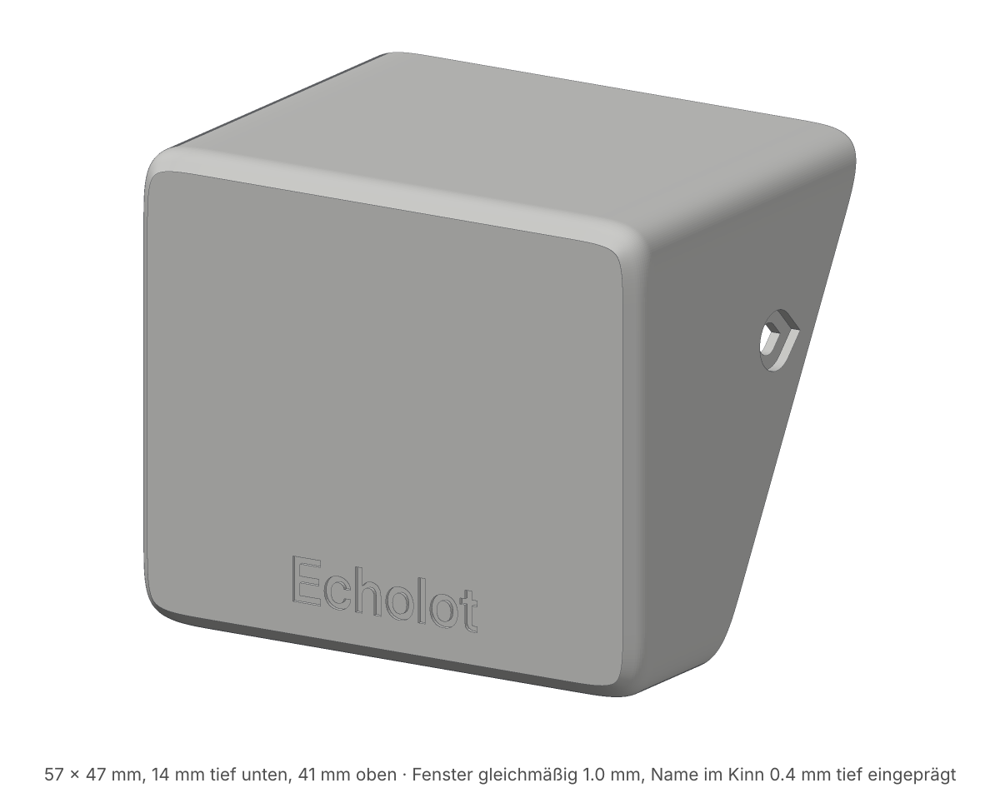
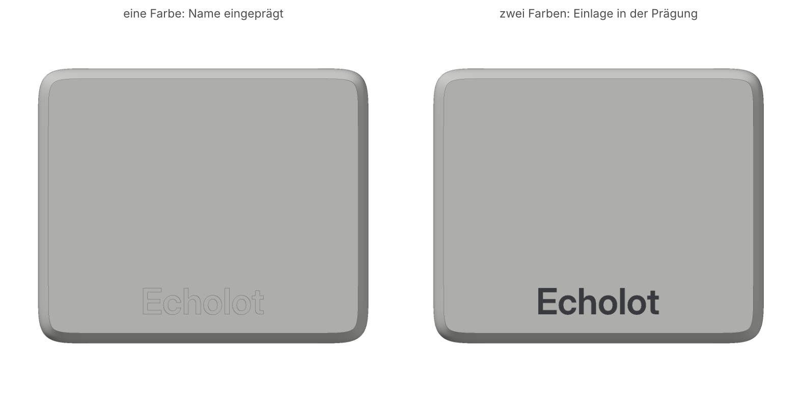
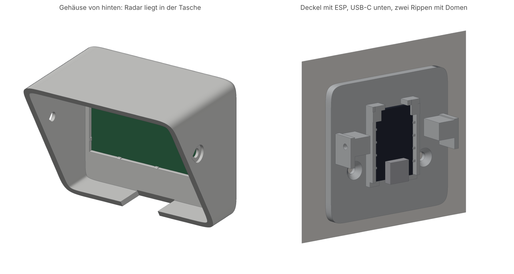
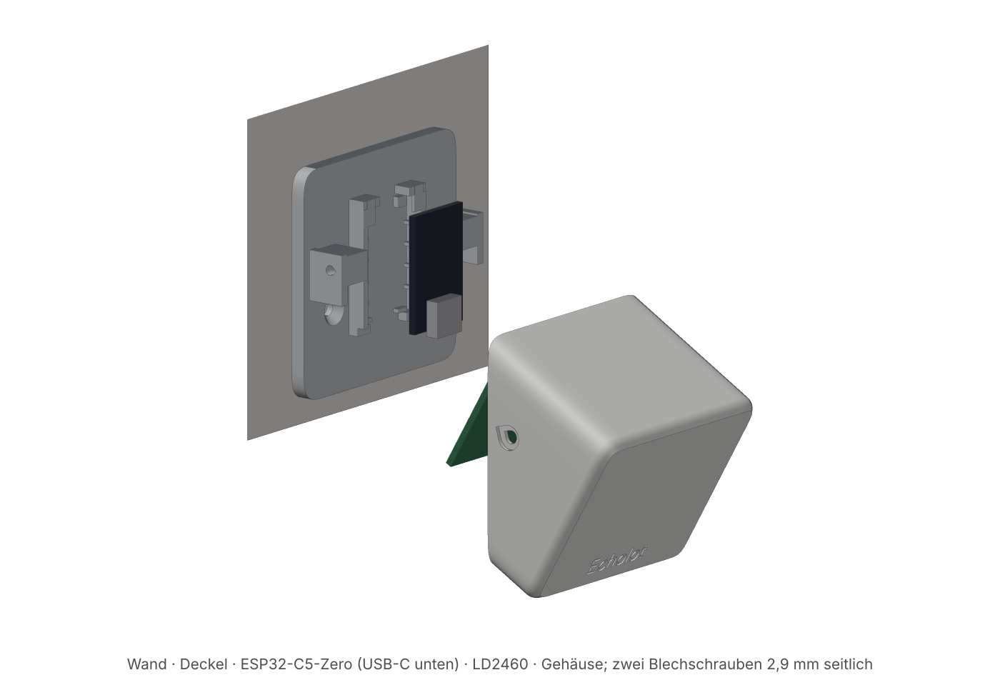
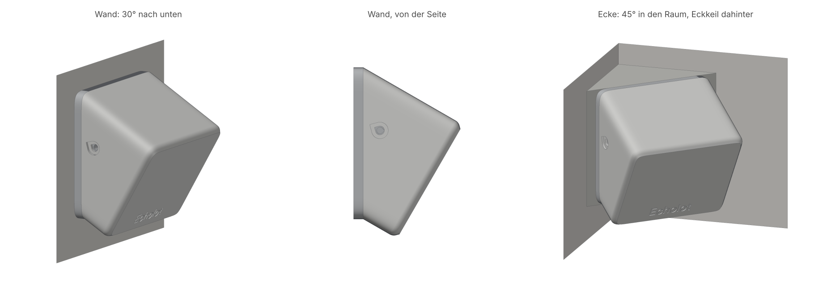
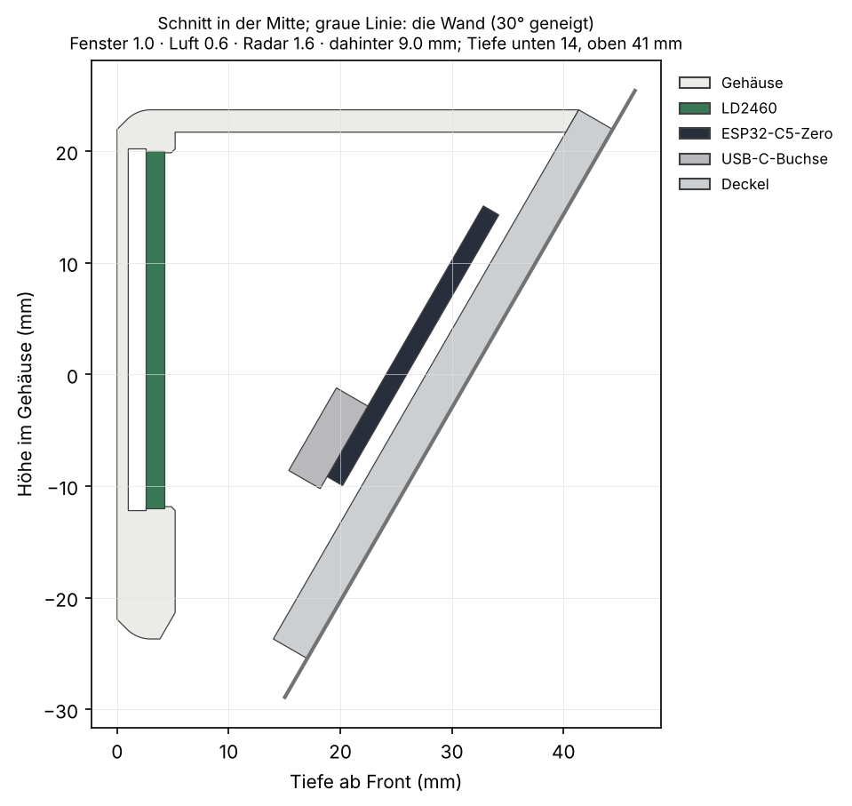

# Gehäuse für LD2460 + ESP32-C5-Zero

Ein schlankes Gehäuse (56,9 × 47,4 mm) für das HLK-LD2460, gestaltet in der
Art von Apple-Geräten, mit dem ESP32-C5-Zero auf einem Deckel dahinter:

- Squircle-Ecken: Die Krümmung setzt sanft ein, ohne Knick.
- Eine weich gerundete Vorderkante.
- Front und Oberseite ohne Schlitze oder Schrauben.
- Unter dem Radarfenster ein schmales „Kinn“ mit dem eingeprägten Namen
  **Echolot** in Inter Display.
- Hinter einem gleichmäßig 1 mm dünnen Fenster sitzt das Radar.

**Das Gehäuse ist der Neigungskeil.** Seine Rückseite liegt 30° schräg, also
neigt es sich von selbst nach unten. Es gibt keine Schiene, keinen Halter
und keine Rastnasen. Zwei Teile, vier Schrauben:

1. Der **Deckel** kommt mit zwei Senkkopfschrauben an die Wand. Auf ihm
   liegt der ESP in einer Tasche, das USB-C-Kabel geht unten heraus.
2. Das **Gehäuse** mit dem Radar wird auf zwei Rippen des Deckels geschoben.
3. Zwei **Blechschrauben 2,9 mm** durch die Seitenwände halten es am Deckel.

In einer Raumecke kommt ein **Eckkeil** zwischen Wand und Deckel. Das
Gehäuse ist dasselbe.













Alle Bilder sind aus genau der Geometrie gerechnet, die in den STL-Dateien
steht.

## Woher die Maße stammen

| Bauteil | Maß | Quelle |
| --- | --- | --- |
| LD2460 | Platine 49,5 × 32,0 mm, Eckenradius etwa 1,8 mm | Hi-Link, *HLK-LD2460 Manual V1.1*, Abschnitt 3.1 (Maßzeichnung) |
| LD2460 | Stiftleisten im 2,0-mm-Raster: **J1** 2 × 4 Pins (3,3 V, GND, Tx2, Rx2 und IO1–4), **JP103** 2 × 2 Pins (5 V, GND, Tx1, Rx1); Lage in der Zeichnung | dort, Abschnitt 3.1 und 3.2 |
| LD2460 | **keine Bohrungen** | am Modul geprüft |
| ESP32-C5-Zero | Platine 18,0 × 28,0 mm, 1,6 mm stark, USB-C bis 4,85 mm über der Rückseite, Lötaugen im Raster 2,54 mm an beiden Längskanten (neun je Seite, das erste 1,59 mm vom USB-Ende), U.FL-Buchse am anderen Ende | Waveshare, `esp32-c5-zero-2D.dxf` |

Nicht im Handbuch stehen die **Platinenstärke** und die **Bauteilhöhen** des
LD2460. Das Gehäuse rechnet deshalb mit Annahmen, die auf der sicheren Seite
liegen. Sie stehen oben in `gehaeuse.py`:

| Annahme | Wert | Wozu |
| --- | --- | --- |
| `RADAR_PCB` | 1,6 mm | Platinenstärke |
| `RADAR_FRONT` | 1,0 mm | zwei kleine Chips auf der Antennenseite (auf Hi-Links Produktfoto zu sehen), QFN-Gehäuse |
| `RADAR_BACK` | 9,0 mm | die beiden Stiftleisten samt aufgesteckter Buchse |
| `RADAR_LOW` | 4,0 mm | alles andere hinter der Platine |

Wer nachmisst und kleinere Werte findet, kann sie eintragen. Das Gehäuse
wird dann nur flacher. Sind sie größer, passt es nicht mehr, und
`pruefen.py` meldet es.

## Teile

| Datei | Teil | Lage beim Druck |
| --- | --- | --- |
| `stl/0_passprobe_radar.stl` | die vorderen 5,8 mm des Gehäuses, zum Probieren | wie im Slicer, Front unten |
| `stl/0_toleranzstreifen.stl` | Streifen, um das Spiel des eigenen Druckers zu finden | liegt flach |
| `stl/1_gehaeuse.stl` | Gehäuse | Front unten |
| `stl/2_deckel.stl` | Deckel mit ESP-Tasche und Rippen | Wandseite unten |
| `stl/3_eckkeil.stl` | nur für die Ecke: Keil zwischen den Wänden | Schrägfläche unten |
| `stl/4_schriftzug_einlage.stl` | nur für zweifarbigen Druck: der Name, 0,4 mm | genau in der Prägung des Gehäuses |

Die Dateien liegen schon richtig herum auf dem Bett. Alle Teile drucken
ohne Stützen: Kein Überhang ist steiler als 50°.

Außerdem:

| | |
| --- | --- |
| 2 × Blechschraube 2,9 × 9,5 mm | Gehäuse am Deckel, Linsenkopf bis 5,5 mm (DIN 7981 / ISO 7049) |
| 2 × 3,5 mm Senkkopf | Deckel an die Wand, mit passenden Dübeln |
| Ecke: 2 × 3,5 × 40 mm | Eckkeil in die Wände, Kopf bis 7,5 mm |
| Ecke: 2 × 3,5 × 14 mm | Deckel auf den Eckkeil, Senkkopf |
| 4-adrige Leitung, etwa 10 cm, mit Buchsen im 2,0-mm-Raster | Radar ↔ ESP (siehe *Zusammenbau*) |

## Festen Sitz

Beide Platinen sitzen ohne Kleber, Klebeband und Bohrungen:

**LD2460**

- Die Platine liegt vorn auf vier Auflagen in den Ecken, auf der
  Antennenseite frei von Bauteilen. Zwischen Chips und Fenster bleiben
  0,6 mm.
- Zehn **Quetschrippen** an den vier Taschenwänden nehmen das Spiel: Die
  Tasche ist je Seite 0,2 mm weiter als die Platine, die Rippen drücken sie
  mit 0,15 mm. Sie verformen sich beim Hineindrücken.
- Es spielt keine Rolle, ob die Platine am oberen oder unteren Ende ihrer
  Toleranz liegt: `pruefen.py` rechnet mit ±0,2 mm. Die kleinste Platine
  berührt noch alle vier Wände, die größte passt noch hinein, ohne zu
  klemmen.
- Die Rippen stehen nicht an den Stiftleisten.

**ESP32-C5-Zero**

- Er liegt auf vier Auflagen unter den Enden. Die Auflagen liegen frei
  von den Lötaugen; die Platine schwebt 1,5 mm über dem Deckel, damit
  Lötstellen an den Lötaugen Platz haben.
- Die Taschenwände stehen 0,9 mm von den Längskanten entfernt, ebenfalls wegen
  der Lötstellen. Je vier **Quetschrippen** an den Wänden stehen genau
  zwischen den Lötaugen und drücken die Platine mit 0,15 mm.
- Zwei Anschläge unten neben der Buchse halten sie beim Ziehen des Kabels,
  zwei oben beim Stecken. Der Stecker hat 12,5 mm Platz.
- Zwei **Haltearme** über den Ecken am Antennenende lassen sie nicht hochkippen.
  Dort liegen keine Lötaugen: Das letzte ist 6 mm vom Ende entfernt.
- Einsetzen: um 3° gekippt, das Antennenende (U.FL) voran unter die Arme
  schieben, dann das USB-Ende absenken.

## Erst messen, dann drucken

1. Das Modul nachmessen, vor allem die **Höhe der Stiftleisten samt
   Buchse** und die **Platinenstärke**, und oben in `gehaeuse.py` unter
   *LD2460* eintragen.
2. `python gehaeuse.py` aufrufen, dann `python pruefen.py`.
3. **Die Passprobe drucken** (`0_passprobe_radar.stl`, wenige Minuten):
   - Das Modul soll sich von hinten mit leichtem Druck hineindrücken
     lassen und dann fest sitzen.
   - Es liegt nur in den vier Ecken auf 3 × 3 mm großen Auflagen. Die
     Ecken der Platine müssen auf der Antennenseite frei von Bauteilen sein.
4. **Den Toleranzstreifen drucken** (`0_toleranzstreifen.stl`, etwa 10
   Minuten). Er zeigt, wie dein Drucker kleine Löcher und Schlitze trifft:
   - Die fünf Kernlöcher sind 2,2 bis 2,6 mm weit. Dreh eine Blechschraube
     2,9 mm hinein: Sie soll sich satt schneiden, ohne zu klemmen oder
     durchzudrehen. Das Modell rechnet mit 2,4 mm (`PILOT_R`).
   - Die fünf Schlitze sind 2,0 bis 2,3 mm breit. Mit dem Messschieber
     siehst du, wie viel schmaler dein Drucker sie druckt. Die Rippen des
     Deckels passen mit 0,15 mm Spiel in das Gehäuse (`RIB_GAP`).

## Der Name

Der Name ist 0,4 mm tief in die Front eingeprägt, also zwei Schichten. Er
liegt im Kinn, nicht im Radarfenster: Das Fenster bleibt überall gleich
dick. Die Front liegt beim Druck auf dem Bett, deshalb werden die
Buchstaben so glatt wie die Druckplatte. Eine glatte Platte gibt eine
feine, saubere Prägung; eine strukturierte Platte prägt ihr Muster mit.

- **Eine Farbe:** nur `1_gehaeuse.stl` drucken.
- **Zwei Farben** (Drucker mit mehreren Filamenten):
  - `1_gehaeuse.stl` und `4_schriftzug_einlage.stl` zusammen laden.
  - Die Frage nach „einem Objekt mit mehreren Teilen“ bejahen. Die
    Einlage liegt dann schon an der richtigen Stelle.
  - Der Einlage die zweite Farbe geben, etwa Weiß mit Space Grau.
  - Die Einlage liegt nur in den ersten zwei Schichten; der Farbwechsel
    kostet also wenig.
- **Ohne Mehrfarbdrucker:** die Prägung mit etwas Acrylfarbe füllen und
  die Front abwischen, solange die Farbe feucht ist.
- Anderer Name oder keiner: `NAME` oben in `gehaeuse.py`.

Schrift: [Inter](https://github.com/rsms/inter) Display SemiBold von
Rasmus Andersson, frei unter der SIL Open Font License (`schrift/`).

## Druckeinstellungen

- **Material:** PETG oder PLA, matt, für den Apple-Look in Weiß oder
  Hellgrau. PETG verträgt die Quetschrippen besser.
- **Kein Filament mit Metall- oder Kohlefaseranteil**, auch keine
  Glitzer- oder Metallicfarbe. Das Radar sendet bei 24 GHz durch die Front.
- **Front massiv:** Die Front ist 1,0 mm dick. Mit 0,2 mm Schichten also
  mindestens 5 Boden-Schichten, damit kein Füllmuster im Fenster liegt.
  Ein Füllmuster im Fenster wäre ungleichmäßig.
- **Schichthöhe** 0,2 mm, 3 Wände.
- **Deckel:** Die Rippen sind 2,0 mm dick und stehen senkrecht auf dem
  Bett; mindestens 3 Wände. Die Haltearme am ESP sind 0,9 mm dick: etwa 2 Linien
  mit 0,4er Düse.
- **Quetschrippen:** langsam und mit kräftiger Kühlung drucken. Die am Radar
  sind nur 0,35 mm hoch, die am ESP 1,05 mm.
- **Eckkeil:** massiv 58 cm³. 15–20 % Füllung reicht; die Schrägfläche
  liegt unten und wird glatt.

Ob das Fenster die Reichweite mindert, ist nicht gemessen. Zum Vergleich:
In Echolot das Modul einmal ohne und einmal hinter der Passprobe laufen
lassen und schauen, ob Ziele an der Raumgrenze gleich weit erkannt werden.

## Zusammenbau und Montage

1. **Verkabeln:** wie in der Echolot-Dokumentation unter *Verkabelung*.
   Nach Hi-Links Handbuch liegen am Modul:
   - **5 V und GND** am Stecker **JP103** (Pin 1 und 2) und
   - **Tx2 und Rx2** am Stecker **J1** (Pin 7 und 8, untere Reihe der
     Zeichnung). Tx1/Rx1 am JP103 sind nicht die Radardaten.
   - Beide Stecker liegen an den kurzen Kanten der Platine. Das Gehäuse
     lässt dafür hinter dem Radar 9 mm frei.
   - Die vier Leitungen zwischen Radar und ESP sollten etwa 10 cm lang
     sein, damit sich das Gehäuse zum Warten abnehmen lässt.
2. **ESP einsetzen:** mit den Bauteilen nach oben, das Antennenende (U.FL)
   um 3° gekippt unter die zwei Arme schieben, dann am USB-Ende absenken.
   Das USB-C-Kabel aufstecken.
3. **Deckel montieren:**
   - **Wand:** an die Stelle halten, durch die beiden Senklöcher anzeichnen,
     bohren, dübeln, mit zwei Senkkopfschrauben festschrauben. Das
     USB-C-Kabel geht unten heraus.
   - **Ecke:** erst den Eckkeil mit den zwei Schrauben in die Wände
     schrauben (die Köpfe sitzen in Senkungen auf der Schrägfläche), dann
     den Deckel mit den zwei kurzen Senkkopfschrauben auf den Keil. Der
     Eckkeil hält den Sensor mit Blick in die Winkelhalbierende.
   - Die Schrauben sitzen hinter dem Gehäuse. Wer nicht bohren will, klebt
     die Wandfläche des Deckels mit Montageklebeband an.
4. **Radar** von hinten in die Tasche des Gehäuses drücken, die Antennenseite
   nach vorn, die lange Seite waagerecht. Von hinten gesehen liegt **JP103
   links** und **J1 rechts**.
   - Mit den Daumen nur auf die Ecken der Platine drücken, nicht auf Bauteile,
     bis sie auf den Auflagen sitzt.
   - Nach dem Einbau in Echolot *Kalibrieren → Achsen* gehen. Das prüft,
     ob links und rechts stimmen.
5. **Leitungen** vom Radar zum ESP anschließen.
6. **Gehäuse** von vorn auf den Deckel schieben: Die Rippen laufen innen an
   den Seitenwänden, das USB-Kabel geht durch die Aussparung unten.
   Dann je eine Blechschraube 2,9 × 9,5 durch die Seitenwand in den Dom,
   nicht überdrehen.
   - Abnehmen: beide Schrauben lösen, das Gehäuse gerade von der Wand ziehen.
7. In Echolot unter **Kalibrieren → Montage** angeben:
   - Wand („side“) oder Ecke („corner“).
   - Die Höhe, in der der Sensor hängt.
   - Neigung **30°**, also dieselbe wie am Gehäuse.
   - Hi-Link empfiehlt an der Wand 2,2–2,7 m Höhe und 25–40° Neigung.

## Anpassen

Alle Maße stehen oben in `gehaeuse.py`. Zum Beispiel:

| Parameter | Bedeutung |
| --- | --- |
| `TILT` | Neigung nach unten; ändert die Schrägfläche des Gehäuses |
| `CORNER_YAW` | Drehung in der Ecke |
| `Z_B0` | Tiefe des Gehäuses an der Unterkante; oben ist es um 47 mm · tan(`TILT`) tiefer |
| `RADAR_PCB`, `RADAR_FRONT`, `RADAR_BACK` | die drei Annahmen über das LD2460 |
| `FIT_R`, `CRUSH` | Spiel der Tasche und Übermaß der Quetschrippen am Radar |
| `ESP_GAP`, `ESP_CRUSH`, `ESP_RIBS` | Abstand der Taschenwände, Quetschung und Lage der Rippen am ESP |
| `RIB_GAP`, `PILOT_R` | Spiel der Rippen, Kernloch der Blechschraube |
| `NAME`, `NAME_CAP`, `NAME_DEPTH` | Name, Schrifthöhe, Prägetiefe |
| `R_OUT`, `SQUIRCLE`, `EDGE_R`, `CHIN` | Form: Ecken, Kantenrundung, Kinn |

Danach:

```
pip install -r requirements.txt
python gehaeuse.py --bilder   # STL-Dateien und Bilder neu
python pruefen.py             # muss mit „Alles passt.“ enden
```

`pruefen.py` setzt alles virtuell zusammen und prüft dabei:

- **Festen Sitz:**
  - Das Radar und der ESP passen mit der größten Platine innerhalb ±0,2 mm,
    und die Quetschrippen berühren noch die kleinste.
  - Die Haltearme liegen mit 0,4 mm Luft über dem ESP und greifen über die
    Ecken; der ESP lässt sich gekippt darunter schieben und absenken.
  - Die Anschläge halten beim Stecken und beim Ziehen.
- **Passung:**
  - Radar, ESP und ein üblicher USB-C-Stecker (12,5 × 6,5 mm) stoßen
    nirgends an; der Stecker hat seine Aussparung.
  - Für die Stiftleisten bleibt 9 mm Platz, für alles andere hinter dem
    Radar 4 mm; der Deckel liegt mindestens 4 mm weiter hinten.
  - Das Gehäuse liegt flach auf dem Deckel; die Rippen haben Spiel in den
    Seitenwänden und stehen nicht an den Stiftleisten.
  - Die Löcher der Seitenschrauben treffen die Kernlöcher in den Domen.
- **Montage:**
  - Das Gehäuse lässt sich über die ganze Strecke auf die Rippen schieben.
  - Die Wandschrauben sind vor dem Gehäuse frei erreichbar.
  - Neigung und Blickrichtung an Wand und Ecke stimmen.
  - Im Eckkeil liegen die Schraubenköpfe unter der Fläche, der Deckel liegt
    ganz auf, und der Griff des Schraubendrehers passt neben die andere Wand.
- **Form:**
  - Der Name liegt im Kinn und auf der ebenen Front.
  - Die Einlage füllt die Prägung genau.
  - Das Fenster ist überall 1 mm dick, die Wände sind nirgends zu dünn.
- **Druck:** In der Drucklage gibt es keinen steileren Überhang als 50°.

## Grenzen

- **Nicht gedruckt:** Das Gehäuse ist am Rechner entworfen und geprüft,
  aber noch nicht gedruckt und nicht mit echter Hardware anprobiert.
  Deshalb zuerst Passprobe und Toleranzstreifen drucken.
- **Annahmen über das LD2460:** Platinenstärke, die Höhe der Chips auf der
  Antennenseite und die der Stiftleisten stehen nicht im Handbuch (siehe
  oben). Die Prüfung rechnet mit ±0,2 mm Platinentoleranz; auch das ist eine
  Annahme.
- **Festen Sitz** sichern die Quetschrippen durch Reibung. Wie fest, hängt
  von Material und Drucker ab; der Toleranzstreifen und die Passprobe zeigen
  es, bevor das ganze Gehäuse gedruckt wird. Das Radar hält nicht in
  Zugrichtung nach hinten, wenn die Platine sehr klein ausfällt; ein Tupfer
  Heißkleber in einer Ecke hilft dann.
- **ESP:** Er hält durch Quetschrippen, Anschläge und Arme. Ob dein Board an
  den Lötaugen Drähte oder Stifte trägt, ist offen: Die Wände stehen 0,9 mm
  von den Kanten, und die Auflagen liegen nicht an den Lötaugen. Ob das Board
  eine Platinenantenne hat oder nur die U.FL-Buchse (die Zeichnung zeigt nur
  sie), steht hier nicht fest; die Mitte am Antennenende bleibt frei.
- **Groß:** Das Gehäuse ist ein Keil: Unten ist es 14 mm tief, oben 41 mm.
  Das ergibt sich aus 30° Neigung bei 47 mm Höhe. Eine kleinere `TILT`
  macht es flacher.
- **Seitenschrauben:** Sie schneiden in Dome aus Kunststoff. Wie oft sich das
  öffnen lässt, ist nicht erprobt.
- **WLAN:** Der ESP sitzt auf dem Deckel direkt an der Wand, hinter der
  Radarplatine. Zum Raum hin schirmt ihre Massefläche das WLAN des ESP ab,
  nach hinten nicht. Ist der Empfang schwach, hilft eine externe Antenne an der
  U.FL-Buchse. Für deren Kabel ist kein Durchlass vorgesehen.
- **Wärme:** Das LD2460 zieht nach Hi-Link höchstens 250 mA bei 5 V, also etwa
  1,25 W. Lüftungsschlitze gibt es nicht; Luft kommt nur durch die
  Aussparung für das USB-Kabel unten. Wie warm es innen wird, ist nicht
  gemessen.
- **Ecke:** Der Eckkeil ist ein massiver Block von 58 cm³ und braucht
  Schrauben von 40 mm. Wände, die nicht rechtwinklig sind, passen nicht.

## Quellen

- LD2460: Hi-Link, *HLK-LD2460 2T4R Multi Target Trajectory Tracking Module
  Manual V1.1*
  ([PDF](https://revspace.nl/images/9/9d/HLK-LD2460_2T4R_Multi_Target_Trajectory_Tracking_Module_Manual_V1.1.pdf)),
  [Hi-Link Produktseite](https://www.hlktech.net/index.php?id=1335)
- ESP32-C5-Zero: Waveshare, `hardware/dimensions/esp32-c5-zero-2D.dxf` im
  Repository [waveshareteam/ESP32-C5-Zero](https://github.com/waveshareteam/ESP32-C5-Zero)
- Montagehöhe und Neigung: Echolot-Dokumentation, Abschnitt *Kalibrieren*
  (nach Hi-Links Handbuch, Abschnitt 6)
